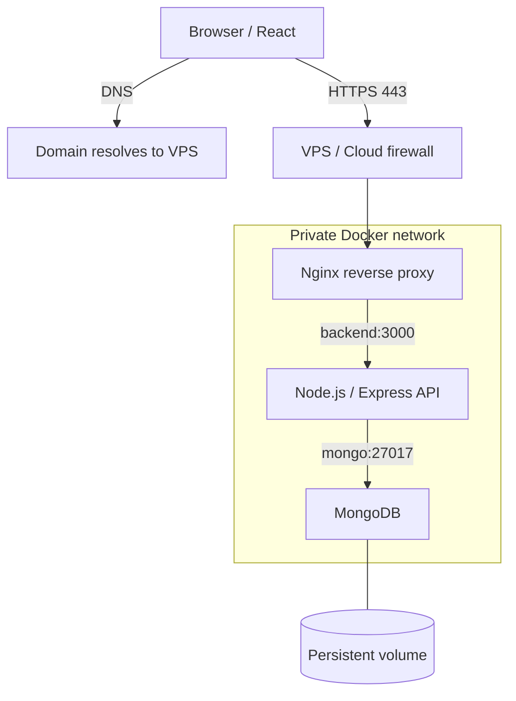
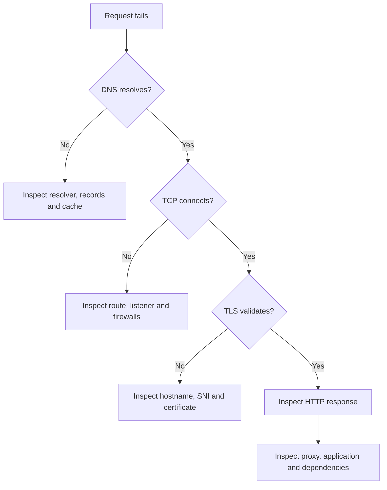

<div align="center">

# Computer Networks Mastery
### From networking fundamentals to production-grade backend networking

A practical learning repository covering TCP/IP, DNS, HTTP, TLS, routing, Linux, packet analysis, Docker, VPS deployment and real-world troubleshooting.

[Roadmap](#learning-roadmap) · [Chapters](#chapter-navigation) · [Labs](#hands-on-labs) · [Architecture](#architecture) · [Interview Prep](#interview-preparation)


</div>

---

## About

This repository is a structured journey to understand computer networks beyond memorizing definitions: what happens on the wire, why systems fail, how to investigate failures, and how networking decisions affect backend applications.

Examples connect networking concepts to browser requests, REST APIs, Node.js/Express, reverse proxies, databases, Linux servers, Docker and VPS deployments.

## Learning objectives

- Understand encapsulation and the roles of link, network, transport and application layers.
- Explain TCP reliability, sequence numbers, acknowledgements, flow control and congestion control.
- Diagnose DNS, routing, TCP, TLS, HTTP and application failures systematically.
- Understand IPv4/IPv6, CIDR, subnetting, NAT, firewalls, VLANs and MTU.
- Use Windows/Linux networking tools, Wireshark and tcpdump.
- Design safer Docker/VPS deployments with controlled public ingress and private services.

## Learning roadmap

Mark a phase complete only after reading its chapter and completing a practical exercise.

| Phase | Focus | Chapter | Progress |
|---|---|---|---|
| 1 | Foundations and encapsulation | [01](docs/01-foundations.md) | ⬜ |
| 2 | Ethernet, MAC, ARP and switching | [02](docs/02-ethernet.md) | ⬜ |
| 3 | IP addressing, subnetting and routing | [03](docs/03-ip-routing.md) | ⬜ |
| 4 | TCP internals and reliability | [04](docs/04-tcp.md) | ⬜ |
| 5 | UDP, QUIC and DNS | [05](docs/05-udp-dns.md) | ⬜ |
| 6 | HTTP, TLS, CORS and reverse proxies | [06](docs/06-web.md) | ⬜ |
| 7 | NAT, IPv6, firewalls and security | [07](docs/07-security.md) | ⬜ |
| 8 | Packet capture and troubleshooting | [08](docs/08-diagnostics.md) | ⬜ |
| 9 | DHCP, VLANs, MTU and performance | [09](docs/09-lan-performance.md) | ⬜ |
| 10 | VPNs, proxies and tunnels | [10](docs/10-tunnels.md) | ⬜ |
| 11 | Docker, VPS and backend architecture | [11](docs/11-docker-vps.md) | ⬜ |
| 12 | End-to-end troubleshooting capstone | [12](docs/12-capstone.md) | ⬜ |

**Progress key:** ⬜ Not started · 🟨 In progress · 🟩 Completed

See the [30-lesson index](docs/lesson-index.md) for the mapping from the original lessons to these consolidated chapters.

## Chapter navigation

| Chapter | Topics |
|---|---|
| [01 — Foundations](docs/01-foundations.md) | Network types, OSI/TCP-IP, encapsulation, identifiers |
| [02 — Ethernet](docs/02-ethernet.md) | Frames, MAC, ARP, switching and VLANs |
| [03 — IP and routing](docs/03-ip-routing.md) | IPv4, private ranges, CIDR, subnetting, gateways, route selection |
| [04 — TCP](docs/04-tcp.md) | Handshake, sequence numbers, ACKs, windows, retransmission, congestion |
| [05 — UDP and DNS](docs/05-udp-dns.md) | UDP, QUIC, DNS hierarchy, records, caching, Docker DNS |
| [06 — Web networking](docs/06-web.md) | HTTP, TLS, cookies, CORS, reverse proxies, Nginx |
| [07 — Security](docs/07-security.md) | NAT/PAT, IPv6, firewalls, least privilege and threats |
| [08 — Diagnostics](docs/08-diagnostics.md) | Troubleshooting, sockets, packet captures, tcpdump, Wireshark |
| [09 — LAN and performance](docs/09-lan-performance.md) | DHCP, VLANs, MTU, PMTUD, latency, throughput, jitter, loss |
| [10 — Tunnels](docs/10-tunnels.md) | VPNs, encapsulation, proxies and SSH forwarding |
| [11 — Docker/VPS](docs/11-docker-vps.md) | Namespaces, Compose DNS, port publishing, Nginx, Express, MongoDB |
| [12 — Capstone](docs/12-capstone.md) | End-to-end production-style troubleshooting |

## Hands-on labs

| Lab | Environment | Practice |
|---|---|---|
| [Windows labs](labs/windows-labs.md) | PowerShell | `ipconfig`, `nslookup`, routes, `tracert`, `Test-NetConnection`, `curl` |
| [Linux labs](labs/linux-labs.md) | Linux | `ip`, `ss`, `dig`, `tcpdump`, Docker DNS |
| [Wireshark labs](labs/wireshark-labs.md) | Wireshark/tcpdump | TCP handshake, DNS, retransmissions and TLS |

### Lab workflow
1. Write the question and your hypothesis.
2. Run one focused test.
3. Record sanitized output and environment details.
4. Explain what the result proves and does not prove.
5. Record alternative explanations and the next test.

## Architecture

A small backend deployment should expose only the intended entry point. The API and database communicate over a private container network.



**Design principles**
- Publish intended web ports, typically 80 and 443.
- Keep Express and MongoDB off the public interface unless there is a deliberate, secured reason.
- Use Docker service DNS names such as `backend` and `mongo` between containers.
- `localhost` inside a container refers to that container's own network namespace.
- Configure TLS, authentication, secrets, backups, health checks, logs and firewall rules deliberately.

See [Docker and VPS networking](docs/11-docker-vps.md).

## Troubleshooting workflow



A successful ping does not prove HTTPS works. A listening socket does not prove public reachability. A 502 and a 504 are clues, not complete root-cause explanations.

## Tools covered

- **Windows:** PowerShell, `ipconfig`, `nslookup`, `route print`, `arp`, `tracert`, `Test-NetConnection`, `netstat`, `curl.exe`.
- **Linux:** `ip`, `ss`, `ip neigh`, `ip route`, `dig`, `getent`, `curl`, `openssl`, `tcpdump`.
- **Packet analysis:** Wireshark display filters and packet inspection.
- **Backend/deployment:** Docker, Docker Compose, Nginx, Node.js/Express, MongoDB and VPS networking.

## Interview preparation

Use the [interview guide](interview/interview-prep.md) for core questions and production-style scenarios:
- What happens after entering a URL in a browser?
- TCP vs UDP; flow control vs congestion control.
- DNS resolution, TTL and authoritative servers.
- NAT vs firewall; listening vs reachable.
- CORS vs authentication; reverse proxy behavior.
- Diagnosing Nginx 502/504, Docker DNS and database connectivity.
- Investigating large uploads that stall due to MTU, PMTUD, proxy limits or application behavior.

## Repository structure

```text
computer-networks-mastery/
├── README.md
├── CONTRIBUTING.md
├── docs/          # 12 detailed chapters + lesson index
├── labs/          # Windows, Linux and Wireshark exercises
├── diagrams/      # Mermaid source diagrams
└── interview/     # Interview questions and scenarios
```

## Personal progress checklist

- [ ] Read each chapter and add explanations in my own words.
- [ ] Complete the related practical lab.
- [ ] Add sanitized terminal output or packet screenshots.
- [ ] Update roadmap progress after completing the work.
- [ ] Add at least one real troubleshooting case study.
- [ ] Revisit interview questions and write answers independently.

## Responsible practice

Run scans and packet captures only on systems and networks you own or are authorized to assess. Captures may contain sensitive information. Do not expose database ports publicly just to test connectivity. Be cautious changing firewall rules on a remote VPS; preserve a recovery path.

---

<div align="center">

**Learn the protocol. Observe the packets. Diagnose the system.**

</div>
